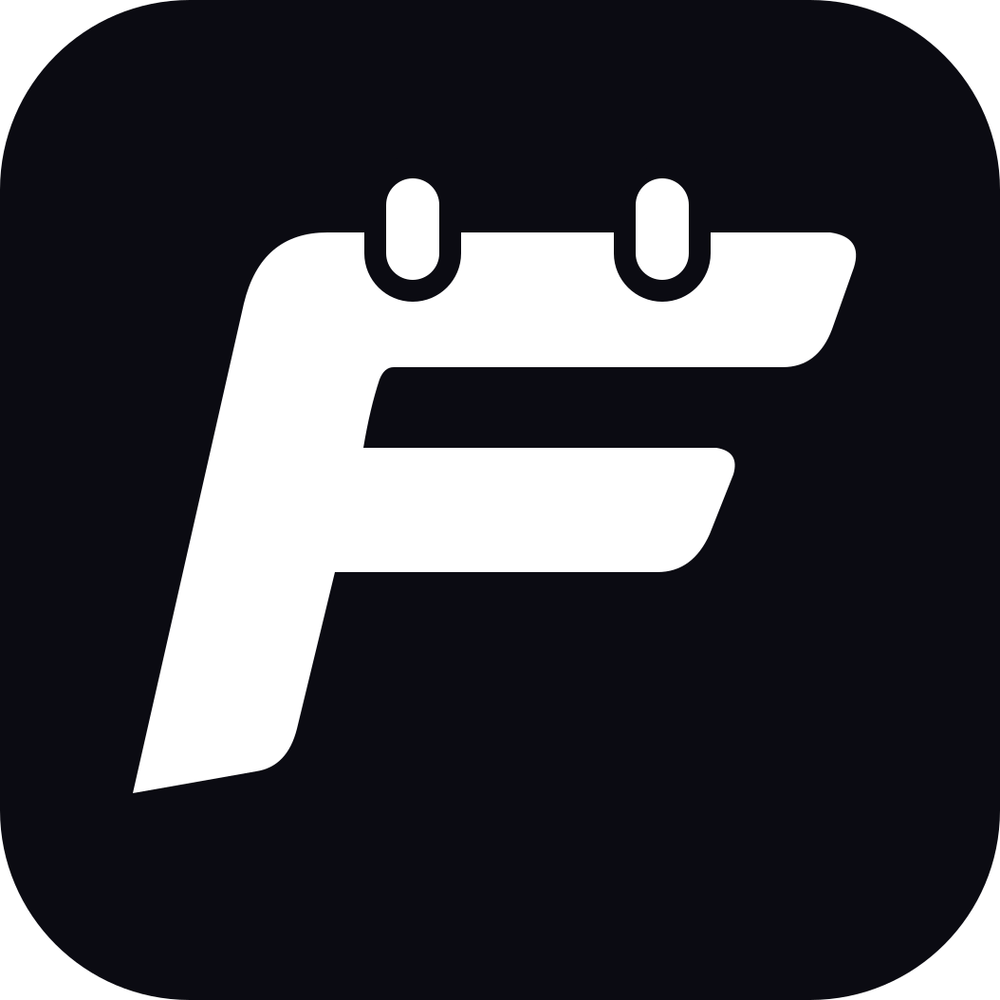

<p align="center">
  <a href="https://www.fixture.nz">
    
  </a>
</p>

<h1 align="center">Fixture</h1>

<p align="center">
  <a href="https://www.fixture.nz"><strong>fixture.nz</strong></a>
</p>

<p align="center">
  Upcoming fixtures and results for my favourite sports in one place.<br>
  A simple, mobile-first PWA sports app without social/advertising/gambling noise.
</p>

<p align="center">
  
</p>

## Features

- **Upcoming, Results and Tables.** Scheduled and live games, recent results, and football league tables, grouped
  by day in your local timezone, covering two weeks either side of today.
- **Live scores.** Games in progress update automatically while the app is open.
- **Pick your leagues, follow your teams.** Turn competitions on or off and star the teams you care about. Cups can
  show only your teams' games. Everything is saved on your device, with no account needed.
- **Match details.** Goals, red cards and stats for finished football games, plus highlights links where available.
- **Installable.** Add it to your home screen as an app on iOS or Android. Dark, Blue and Light themes.

## Competitions

| Sport | Competitions |
|---|---|
| Rugby union | Super Rugby Pacific, Nations Championship, The Rugby Championship, Rugby World Cup, All Blacks Tests |
| Rugby league | NRL |
| Aussie rules | AFL |
| Football | Premier League, UEFA Champions League, A-League Men, FIFA World Cup |
| Basketball | NBA |
| Motorsport | Formula 1, Supercars |

## Tech stack

- [Next.js 16](https://nextjs.org) (App Router), React 19, TypeScript and Tailwind CSS v4
- [Supabase](https://supabase.com) Postgres with [Drizzle ORM](https://orm.drizzle.team)
- Data from [TheSportsDB](https://www.thesportsdb.com)
- Hosted on [Vercel](https://vercel.com), with the data sync scheduled by Supabase `pg_cron`

## How it works

A sync job runs every two minutes and decides which leagues are due for a refresh: every run while a game is live,
every 15 minutes on match days, and every few hours otherwise. It fetches only those leagues from TheSportsDB and
writes only what changed. The page itself is statically rendered and cached, and is regenerated only when the data
changes, so viewers never hit the database directly.

## JSON feed

`https://www.fixture.nz/api/feed` serves upcoming fixtures or recent results as JSON, filterable by league and team,
for dashboards such as [Homepage](https://gethomepage.dev). See [docs/feed-api.md](docs/feed-api.md).

## Running locally

```bash
npm install
npm run dev
```

Open [http://localhost:3000](http://localhost:3000). Without a `DATABASE_URL`, the app serves built-in mock data, so
no setup is needed to work on the UI.

To run against a real database, create `.env.local` with:

| Variable | Purpose |
|---|---|
| `DATABASE_URL` | Supabase Postgres connection string (Session Pooler) |
| `THESPORTSDB_API_KEY` | TheSportsDB v1 API key |
| `CRON_SECRET` | Bearer token required by `/api/cron/sync` |

Then push the schema, seed the leagues and teams, and run a sync:

```bash
npm run db:push
npm run db:seed
npm run sync:all     # with the dev server running
```

### Scripts

| Command | What it does |
|---|---|
| `npm run dev` | Start the dev server |
| `npm run build` / `npm run start` | Build and serve for production |
| `npm run lint` / `npm run typecheck` | ESLint and TypeScript checks |
| `npm run db:push` | Push the Drizzle schema to the database |
| `npm run db:seed` | Seed sports, leagues, seasons and teams |
| `npm run season` | List seasons, or roll a league to a new one |
| `npm run sync` / `npm run sync:all` | Run the sync for due leagues / every league |
| `npm run icons` | Regenerate the app icons from `src/app/icon.svg` |

For a detailed guide to the architecture, sync and conventions, see [CLAUDE.md](CLAUDE.md).
